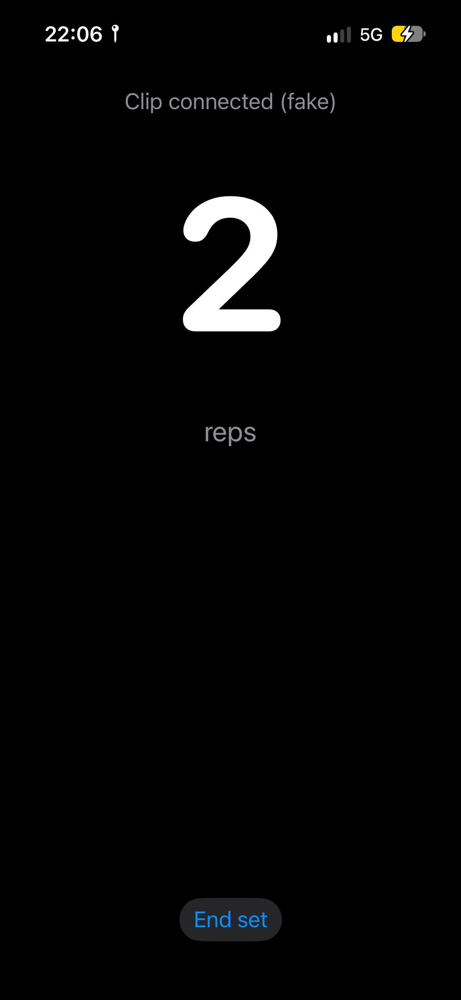
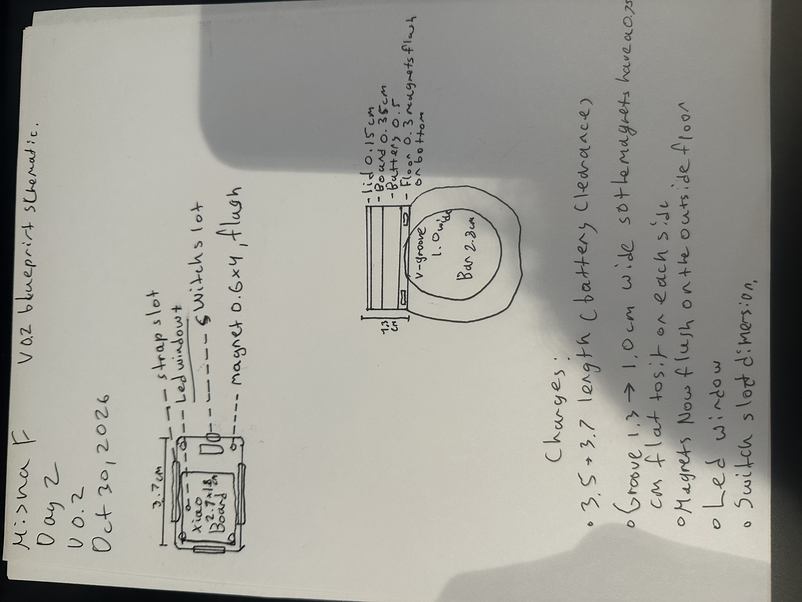
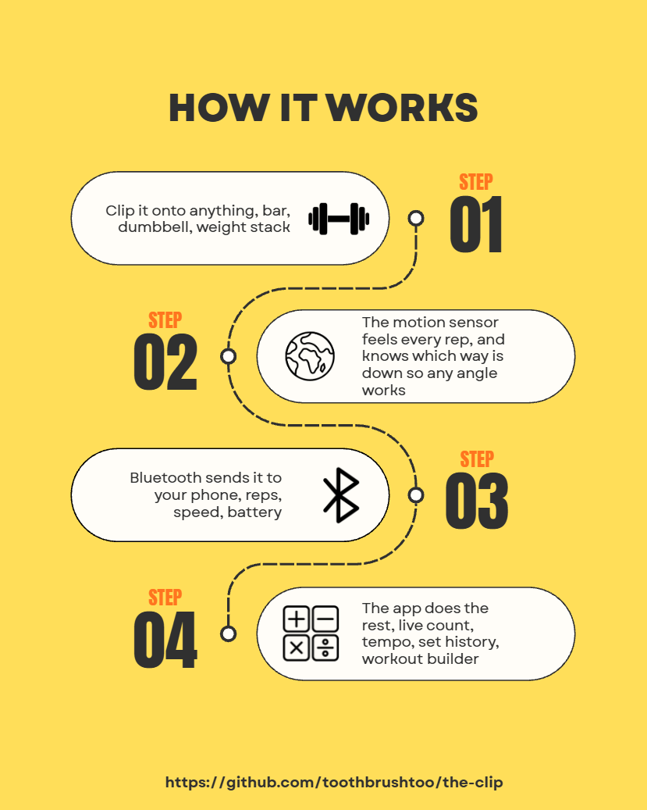

  
  &nbsp;&nbsp;
  

# the-clip

**One clip that turns any gym equipment into a smart machine.**

Status, Oct 31: app v0.3 running on iPhone with set history · rep counter working on phone data (10/10 sideways, 0 false reps walking) · board, battery and switch ordered, arriving the week of Nov 5 · case v0.2 drawn.

A small sensor you clip on a barbell, dumbbell,  cable stack, or machine arm. It counts your reps and sets, measures how fast you moved the weight, and sends it all to an iOS app. The app also builds you a workout from the muscle groups you pick.

Built for Hack Club Fallen (Oct-Dec 2026).

## Why

Every gym tracker only works  on one thing: a bar, or a specific machine, or your wrist. I wanted one device that works on everything in the gym, so i never have to count reps or type them into a phone between sets.

## What it does

- Counts reps and sets automatically
- Measures rep tempo and bar speed
- Calculates joules per rep on free weights (you enter the load once)
- Works in any orientation, so it doesnt matter how you clip it on
- Clips to: barbell, dumbbell, cable stack, machine arm, weight stack (magnets grab the steel stack; the strap is for round bars)
- iOS app: live rep counter, set summary, history
- Workout builder: pick muscle groups + the equipment you have, get a workout
- Find my clip: flashes the LED and shows Bluetooth signal strength in the app

## What it does NOT do (yet!)

- Auto-detect which exercise you're doing
- Measure force or strain
- Progression / coaching logic
- Resistance bands (nothing to clip to)
- Buzzer for find-my-clip (v0.3 if the case has room!)

## Hardware

- Board: Seeed XIAO nRF52840 Sense Plus (BLE + built-in IMU)
- Battery: 3.7 V 250 mAh LiPo, charged over USB-C
- Mount: 20 mm hook-and-loop strap for round bars + magnets for flat steel (machine arms, weight stacks)
- Target size: about 37 × 25 × 13 mm (v0.2)
- Enclosure: 3D printed
- Sketches: hardware/sketches/ (v0.1 Oct 29, v0.2 Oct 30)
  
## Software

- Firmware: Arduino / C++ on the nRF52840
- App: SwiftUI + CoreBluetooth
- Exercise data: free-exercise-db (open source)
- App build: Github Actions (free macOS runner),installed with Sideloadly

## How it works

The IMU streams acceleration over BLE. The firmware figures out which way gravity is pointing, so the clip works no matter how its mounted, then integrates acceleration into velocity  to find each rep. The app does the counting, the set detection and the math.

## Repo layout
- `firmware/`   - code that runs on the clip
- `app/`        - the iOS app
- `demo/`       - videos, test numbers, stuff for the final demo
- `hardware/`   - the actual parts

## Open questions

- Where do i 3D print the case?
- Is a 250 mAh battery enough for a full week of gym sessions (and whats the power draw)
- Will the strap hold the clip steady on a bar or will it rotate during a heavy set?

## Progress 

- Day 1 (Oct 29): Decided on the project, wrote the list of things it can do and finished the ReadME, picked the board (this was a hard one haha) picked a big battery for demo day safety set a size target which is realistic (35 x 25 x 13) mm, set up the whole repo, made sketches and plans. App will be built on GitHub actions (free macOS runner) installed with sideloadly. Ordered all parts
- Day 2 (Oct 30): finished testing lots of stuff with phyohox wrote a py program that can count reps from the graph.
- Day 3

